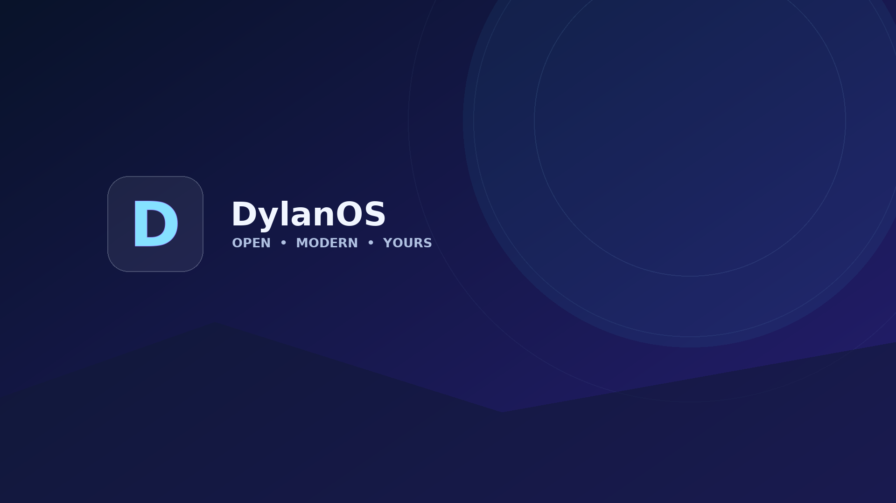
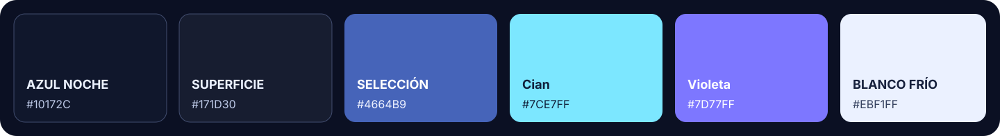

# Identidad visual y escritorio

DylanOS usa una paleta oscura de azul noche con acentos cian y violeta. Los valores siguientes se derivan de los recursos SVG y de los archivos de tema existentes; no implican que todas las aplicaciones de terceros usen el mismo esquema.

<p align="center">
  
</p>

<p align="center">
  
</p>

| Color | HEX | Uso de referencia |
|---|---|---|
| Azul noche | `#10172C` | Fondo de GRUB y superficies profundas |
| Azul marino | `#171D30` | Ventanas y elementos de Plasma |
| Azul selección | `#4664B9` | Selección en el esquema de Plasma |
| Cian | `#7CE7FF` | Acento y estados activos |
| Violeta | `#7D77FF` | Acento secundario del icono |
| Blanco frío | `#EBF1FF` | Texto sobre fondos oscuros |

## Qué instala el constructor

- `branding/logo.svg`, `branding/icons/dylanos.svg` y `branding/wallpapers/`: identidad de la distribución, icono de aplicación y fondos.
- `themes/plasma/DylanOS.colors` junto con `configs/plasma/kdeglobals`: esquema de colores inicial para cuentas creadas desde `/etc/skel`.
- `themes/gtk/`: preferencias GTK de Breeze y preferencia por tema oscuro.
- `themes/sddm/10-dylanos.conf`: selecciona el greeter Breeze incluido en el sistema; no es un tema SDDM totalmente nuevo.
- `themes/grub/` y `branding/splash/`: recursos y configuración de GRUB y Plymouth.
- `configs/plasma/dylanos-welcome*.desktop`: entrada del menú de aplicaciones y autoinicio de bienvenida.

El escritorio conserva componentes de Breeze. Los temas de aplicaciones GTK/Qt pueden variar según la aplicación y su propia configuración.

## Fondo de pantalla

El fondo incluido no se cambia automáticamente al iniciar sesión. Para aplicarlo a la sesión actual de Plasma:

```bash
dylanos-wallpaper
```

El comando usa el helper `plasma-apply-wallpaperimage`, requiere una sesión gráfica KDE activa y solo modifica la configuración del usuario actual. Consulta [Herramientas](commands.md#dylanos-wallpaper).

## Panel y dock

El repositorio no instala actualmente una configuración propia de paneles o dock de Plasma. Por ello, la disposición inicial depende del perfil de KDE/Debian presente en la imagen; no se debe asumir que haya un dock superior personalizado. Para corregir nombres de lanzadores o etiquetas cortadas se necesita identificar la aplicación y revisar la disposición real del panel en una captura.
